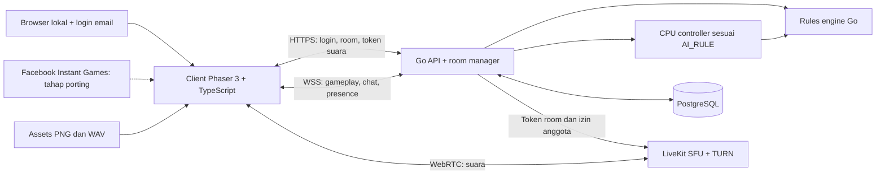

# Rencana MVP Naruto Online — Web Lokal, lalu Facebook Instant Games

Pembaruan: 9 November 2026. Status: integrasi arena 1 sudah dapat dimainkan lokal; porting Facebook dan sertifikasi PS1 1:1 masih tahap berikutnya.

Implementasi berjalan tersedia di [README](README.md): Phaser 3/Vite JavaScript, Go + Goja untuk menjalankan source aturan hasil rekonstruksi, PostgreSQL, WebSocket, Mailpit dan LiveKit. Login → room → pertandingan → hasil/rematch, chat/voice, disconnect CPU dan reclaim sudah terhubung. CPU berjalan dengan kebijakan lokal bernama `local-party-v1`; detail adaptasi dan ketidakpastian dipisahkan dari klaim CPU original dalam [dokumentasi engine](server/internal/game/README.md). Bagian rencana di bawah tetap menjadi acuan hardening/fidelity dan tahap Facebook, bukan pernyataan bahwa seluruh acceptance 1:1 telah terpenuhi.

Pengembangan dan pengujian dimulai sebagai **website lokal**. Pemain wajib register/login dengan email sebelum mengakses room. Setelah gameplay, multiplayer, CPU pengganti, chat, voice dan mobile stabil, aplikasi baru diporting ke **Facebook Instant Games**. Game ditulis ulang tanpa emulator, menggunakan Phaser 3, backend Go, PostgreSQL dan WebSocket. Aset bersumber dari `assets/`; aturan permainan mengikuti [GAME_RULE.md](../GAME_RULE.md) dan keputusan CPU mengikuti [AI_RULE.md](../AI_RULE.md).

## 1. Hasil MVP dan batas cakupan

Alur utama lokal: buka website → register email atau login → daftar room → gabung room yang tersedia atau buat room dan pilih arena → pilih karakter dan ready → bermain arena 1 → hasil pertandingan → kembali ke room. Pengguna yang belum login diarahkan ke halaman autentikasi; API room dan WebSocket juga wajib memeriksa sesi.

| Fitur | Keputusan MVP |
| --- | --- |
| Mode | Party individu dengan aturan normal; seluruh mekanik yang dapat dicapai pada konfigurasi ini harus berjalan. |
| Autentikasi lokal | Register email + password + nama tampilan, login, logout dan pemulihan password. Semua fitur room memerlukan sesi sah. |
| Peserta | Match dimulai oleh 2–4 manusia, termasuk 3 pemain. Pemain yang disconnect saat match digantikan CPU server mengikuti AI_RULE; tidak ada kursi CPU tambahan saat membuat room pada MVP. |
| Arena | Pilihan arena tetap tersedia, tetapi hanya **Arena 1 / map ID 0** yang aktif. |
| Karakter | Default 4 karakter awal ID 0–3, mengikuti ketersediaan awal asli. Aset 13 karakter tetap tersedia; membuka sisanya memerlukan keputusan progression tersendiri. |
| Room | Daftar publik, pencarian nama, filter slot kosong, buat room publik atau privat dengan kode undangan, join, leave, host dan ready. |
| Chat | Chat teks anggota room, tersedia di waiting room, pertandingan dan hasil. |
| Voice | Voice room maksimal 4 orang, join/leave terpisah, mute mikrofon, deafen, mute per peserta, indikator berbicara. Tanpa video atau rekaman. |
| Mobile | Touch sebagai input utama; portrait dan landscape, reconnect setelah app masuk background. |
| Penyimpanan | Identitas pemain, preferensi, room, keanggotaan, match, event, snapshot, hasil dan laporan moderasi. |
| Di luar MVP lokal | Facebook SDK/publikasi, cerita, arena lain, tim, CPU pilihan manual saat membuat room, ranking kompetitif, monetisasi, penonton, pesan pribadi dan panggilan lintas-room. CPU pengganti disconnect termasuk MVP. |

Empat varian Party disiapkan sebagai konfigurasi server, tetapi tidak otomatis dibuka pada MVP. Aturan asli mengunci varian/karakter melalui progres cerita, sementara hasil Party tidak memberikan unlock. Jangan membuat sistem unlock berdasarkan kemenangan Party. Profil QA boleh membuka pilihan untuk pengujian, tetapi tidak menjadi default pemain publik.

Ini MVP multiplayer berdasarkan aturan yang telah ditelusuri, **bukan klaim replika PS1 1:1 bersertifikat**. Kebijakan jaringan, pergantian kontrol manusia/CPU, identitas web/Facebook, room dan chat adalah tambahan online. Ketergantungan RAM asli, seluruh RNG lintas-scene dan sebagian presentasi pertarungan belum terbukti identik; lihat [kontrak 1:1](../research/party-1to1-contract.md).

## 2. Lingkungan lokal dan autentikasi email lebih dahulu

Siapkan Docker Compose untuk PostgreSQL, migrasi dan server voice lokal; jalankan Go API dan Vite client dengan konfigurasi development. Proxy `/api`, `/ws` dan `/assets` melalui origin web yang sama. Satu perintah setup dan dokumentasi menjalankan server harus tersedia, termasuk seed arena 1. Gunakan akun email terpisah pada browser/profile berbeda untuk menguji 2–4 peserta.

Alur autentikasi development:

1. Register dengan email, password dan nama tampilan; server menormalisasi email dan menjamin keunikannya. Password disimpan dengan password hash adaptif dan salt, bukan plaintext atau hash umum cepat.
2. Login menghasilkan sesi server dengan cookie HttpOnly, SameSite dan Secure pada HTTPS; logout mencabut sesi. Form mutasi memakai proteksi CSRF/origin yang sesuai model sesi.
3. Sesi diperiksa pada API daftar/create/join room, koneksi WebSocket, resume match, chat dan permintaan token voice. Mengetahui room ID tidak memberi akses tanpa autentikasi/membership.
4. Verifikasi email dan reset password memakai token sekali pakai dengan kedaluwarsa; simpan hash token. Gunakan penangkap email lokal seperti Mailpit untuk development sehingga tidak membutuhkan pengiriman email publik. Developer dapat mengonfirmasi email lewat inbox lokal.
5. Batasi percobaan login/register/reset; jangan mencatat password atau token dalam log. Akun tester juga harus melewati login, tanpa bypass guest pada halaman room.

Uji pertama di browser desktop melalui localhost: register → login → buat/join room arena 1 → WebSocket → WAV → voice. Untuk pengujian ponsel melalui LAN, sediakan HTTPS dengan sertifikat yang dipercaya perangkat dan WSS serta konfigurasi alamat/port media voice yang dapat dicapai. `http://IP-LAN` tidak boleh diasumsikan memiliki izin capture mikrofon yang sama dengan localhost. Standar capture memerlukan konteks aman serta izin; lihat [Media Capture and Streams](https://www.w3.org/TR/mediacapture-streams/) dan [getUserMedia](https://developer.mozilla.org/en-US/docs/Web/API/MediaDevices/getUserMedia).

Facebook tidak menjadi dependensi boot lokal. Definisikan adapter platform/auth agar browser memakai identitas email dan, pada tahap porting, Facebook memakai identitas SDK yang diverifikasi Go. UUID pemain internal tetap sama konsepnya; linking akun harus melalui sesi dan bukti kepemilikan kedua identitas, bukan mencocokkan nama/email otomatis.

Gate tahap lokal: empat akun dapat login, membuat/mengikuti room, menyelesaikan pertandingan dengan pergantian CPU/reconnect, serta memakai chat dan voice di perangkat pengujian. Setelah acceptance ini stabil, lanjutkan porting Facebook pada bagian 15.

## 3. Arsitektur



- **Client:** Phaser 3 + TypeScript + Vite; pin versi Phaser 3 yang diuji, jangan mengikuti major terbaru secara otomatis. Phaser mengurus papan, animasi, roulette dan input. DOM overlay mengurus input chat/keyboard, dialog dan aksesibilitas, tetap menggunakan skin aset yang sama.
- **Backend:** satu aplikasi Go modular untuk MVP: auth email, room, match, CPU controller, chat dan penerbitan token voice. Satu antrean pemrosesan per match memastikan aksi manusia, takeover CPU dan reclaim berurutan; host room bukan server permainan.
- **Database:** PostgreSQL untuk data persisten dan recovery. State aktif boleh berada di memori, tetapi keputusan yang sudah diakui client harus tahan restart.
- **Transport game:** HTTP/WS melalui localhost diperbolehkan untuk development; HTTPS/WSS untuk LAN mobile dan deployment. Gameplay, chat dan presence memakai WebSocket. Audio percakapan memakai transport WebRTC terpisah.
- **Voice:** LiveKit SFU terpisah sebagai usulan implementasi, dengan TURN untuk jaringan yang memerlukannya. Backend aplikasi tetap Go dan PostgreSQL. LiveKit menyediakan server Go/WebRTC; deployment dan autentikasinya mengikuti [repositori resmi](https://github.com/livekit/livekit), [deployment](https://docs.livekit.io/transport/self-hosting/deployment/) dan [token auth](https://docs.livekit.io/frontends/build/authentication/).
- **Operasional awal:** localhost/LAN, satu proses game aktif, PostgreSQL dengan volume persisten, server voice dan inbox email development. Compose tidak boleh memerlukan akun Meta. Setelah pengujian matang, siapkan staging dan kemudian deployment sesuai kebutuhan Facebook. Tidak memerlukan Redis untuk game MVP; jika nanti konfigurasi cluster SFU memerlukannya, catat sebagai infrastruktur voice terpisah.

## 4. UX room dan alur pemain

**Daftar room setelah login:** kartu room berisi nama, host, thumbnail arena 1, peserta/kapasitas, status waiting/playing, indikator voice diaktifkan dan tombol gabung. Pemain dapat langsung memilih room waiting yang sudah dibuat atau menekan “Buat room”. Urutkan room yang dapat diikuti terlebih dahulu; pagination berbasis cursor, update perubahan melalui WebSocket. Room privat tidak muncul di daftar publik.

**Buat room:** nama, public/private, kapasitas 2/3/4, arena, target chakra dan voice on/off. Default arena 1, aturan normal, target 3000. Validasi server hanya menerima arena aktif; menambahkan arena nanti cukup menambah data dan dependensi aset.

**Pemilih arena:** tampilkan thumbnail arena 1, ringkasan 22 petak dan tombol pilih. Jangan tampilkan arena lain sebagai pilihan yang dapat ditekan sebelum datanya siap. Peta mempunyai ID internal 0, bukan 1; ID tampilan boleh `arena-1`.

**Waiting room:** slot peserta, karakter, ready/unready, pengaturan host, chat dan tombol join voice. Perubahan pengaturan membatalkan ready semua anggota dan menaikkan `roomVersion`. Host dapat memulai jika jumlah peserta sah, semua siap dan aset minimum tiap client sudah dimuat. Snapshot pengaturan terkunci saat match dibuat.

Join/kick hanya saat waiting. Mulai pertandingan dan perebutan slot dilakukan atomik agar dua request tidak memenuhi kursi terakhir bersamaan. Host yang keluar dari waiting room diganti anggota dengan urutan join terawal. Disconnect pada waiting room membatalkan ready dan menahan kursi 30 detik untuk reconnect, kemudian mengeluarkan anggota dan memilih host baru bila perlu; tidak membuat bot sebelum match. Saat match berjalan, kursi dan karakter tetap milik peserta semula, sementara CPU dapat mengambil alih kontrol. Pemain baru tidak dapat mengklaim kursi itu. Penggantian host tidak memengaruhi otoritas game.

Setelah hasil, pemain kembali ke room dan dapat rematch dengan state baru. Tidak menambah unlock cerita. Statistik online untuk analitik dipisahkan dari progres PS1.

## 5. UI memakai aset yang sudah ada

Inventaris sekarang: **958 PNG dan 583 WAV**, sekitar 82,9 MB keseluruhan; WAV sekitar 77,0 MB. Folder `client/`, `server/`, `scheme/` dan `PLAN.md` telah disiapkan. Server HTTP dan route OpenAPI sudah dibuat; autentikasi, room, gameplay dan WebSocket bisnis belum diimplementasikan.

| Tampilan | Sumber |
| --- | --- |
| Arena | `assets/image/arena1/map_00.png`, data 22 petak di `map_00.json` |
| Karakter dan animasi | `assets/sprite/board-characters/characters.json` dan sheet PNG yang direferensikan |
| HUD, potret, angka, roulette | `assets/sprite/common/`, `assets/sprite/hud/` |
| Penghalang, kristal dan objek | `assets/sprite/board/` |
| Kartu dan hasil | `assets/image/cards/`, `assets/image/results/` |
| Font/atlas | `assets/texture/`; path dan hash PNG dari metadata tekstur |
| Musik, efek dan seruan | `assets/metadata/audio/catalog.json` → WAV di `assets/audio/` |

Bangun komponen panel, tombol, slot pemain dan dialog dari potongan aset yang cocok. Jangan menambahkan ilustrasi baru sebagai pengganti aset asli. Jika aset ikon chat/mic tidak tersedia, gunakan label teks dan bentuk UI sederhana yang mengikuti warna/panel lama; ini elemen UI online baru. Teks nama pemain/chat/Indonesia memakai font sistem yang mendukungnya karena atlas Jepang tidak menjamin cakupan karakter tersebut.

Muat frame, durasi, anchor, rotasi dan skala dari metadata animasi. Perlakukan `assets/` sebagai root semua path registry, bukan root proyek. Gunakan `canonicalPath` dari [registry](assets/resource-library.json); arena baru mereferensikan aset bersama tanpa menyalin ulang. Texture metadata `file` relatif ke `assets/texture/`.

Exporter lama masih menggunakan default tujuan sebelum folder aset dipindah. Pada tahap fondasi, sesuaikan default/CLI ke `Naruto-Online/assets` dan uji agar tidak membuat `audio/`, `image/` dan `texture/` duplikat di root proyek. Sumber gambar hanya PNG, sumber audio game hanya WAV; runtime tidak membutuhkan TIM/SEQ/VAB. Live voice memakai codec transport WebRTC, bukan berkas aset WAV; ketentuan WAV tetap berlaku untuk aset game yang disimpan.

## 6. Implementasi rules engine

Port aturan ke package Go murni tanpa Phaser, WebSocket atau SQL di dalam fungsi aturan. Input: state + command sah + tick logis. Output: state baru + events + pilihan tindakan berikutnya. Gunakan angka integer, pembulatan, clamp, urutan pemeriksaan dan RNG sesuai sumber.

Sertakan hash/version `GAME_RULE.md`, tabel arena/dek/teknik dan versi engine pada setiap match. Data ekonomi, koneksi petak, dek 0 serta teknik harus diekstrak dari tabel riset yang dirujuk dokumen, divalidasi dan dipin; jangan menyalin angka secara manual ke berbagai komponen UI.

| Modul wajib | Perilaku yang menjadi acceptance |
| --- | --- |
| Setup | 2–4 peserta; 1500 chakra, target default 3000, bonus dasar 400, poin awal 3 dan +4 per bonus. Target 0–99999, bukan nol berarti unlimited. |
| Giliran | Status awal, menu sebelum bergerak, ninjutsu dan kartu dengan jatah terpisah; gulungan dapat mengakhiri giliran tanpa roulette. |
| Roulette | 12 slot map 0: 1,2,2,3,3,3,4,4,4,5,5,6. Hasil pada benturan palu kedua, bukan random saat tap. Langkah tetap melewati roulette. |
| Gerak/petak | Koneksi asli, kejadian saat lewat/berhenti, kristal, sumber, kartu, penghalang dan jebakan dalam urutan asli. |
| Ekonomi | Harga per petak, level 1–5, HP, biaya upgrade, rangkaian, rent, perbaikan, penjualan paksa pada cabang yang benar, clamp −9999..99999. |
| Kartu | Dek 0: 51 entri/29 ID; pool, tangan, pengembalian, inventori penuh, batas penggunaan, cancel dan target sah. Implementasikan seluruh cabang yang dapat dicapai, bukan undian dari 52 ID. |
| Ninjutsu/status | Daftar Party karakter, poin maksimum 8, biaya/sasaran, overwrite efek dan pemulihan kerasukan. Teknik terkunci tetap terkunci. |
| Pertarungan | Kartu/teknik, biaya sebelum uji keterjangkauan, roulette kedua pihak, jarak map 0, penangkal, damage, rent dan perpindahan penghalang. |
| Gulungan | Perolehan/perebutan/perlindungan, counter dan empat kekuatan dengan syarat asli. |
| Kemenangan | Cek pada penyelesaian bonus sumber; mencapai target di petak lain tidak otomatis menang. |
| Hasil/menyerah | Urutan dan badge asli; konfirmasi menyerah mengakhiri match Party dengan cabang hasil khusus, bukan sekadar menghapus satu peserta. |

Gunakan state machine eksplisit: `TURN_START → PRE_MOVE → ROULETTE/FIXED_MOVE → MOVEMENT → TILE_RESOLUTION → COMBAT/SOURCE_BONUS → TURN_END → RESULTS`, dengan substate target, dialog, pembayaran dan antrean delta. Diagram ini kerangka; urutan detail mengikuti sumber, bukan memaksa semua efek masuk urutan sederhana yang sama.

Fixture awal berasal dari modul riset `party-outcomes`, `faithful-rules`, `faithful-combat`, audit roulette dan tabel peta. Buat matriks requirement → fungsi sumber → test → status. Jangan menganggap 11 test hasil Party yang sudah ada mencakup seluruh permainan.

Varian 0x1/0x2/0x4/0x8 memakai pilihan tunggal, bukan kombinasi bit bebas. Untuk ekspansi nanti, eliminasi saldo nol yang bergantung `board+0x58b` tetap menjadi kasus belum terbukti tanpa RAM. Jangan mengarang default pemenang dan menyebutnya aturan asli. Mode ini tidak masuk konfigurasi produksi MVP sampai ada kontrak kasus tersebut yang disepakati.

Presentasi pertarungan memakai UI, potret dan sprite yang tersedia. Bila koreografi/aset pertarungan PS1 belum dipetakan lengkap, tandai kesenjangan presentasi; jangan menyatakan animasi 1:1 hanya karena rumus damage sudah cocok.

## 7. Sinkronisasi, RNG dan koneksi putus

Server memutuskan giliran, pilihan sah, chakra, kartu, RNG dan hasil. Client hanya mengirim niat tindakan seperti `roll.start`, `roll.stop`, `card.use`, `technique.select`, `tile.buy`, `battle.confirm` dan `surrender.confirm`. Jangan menerima chakra akhir, hasil dadu atau damage dari client.

Envelope command: `protocolVersion`, `commandId`, `matchId`, `expectedStateVersion`, `type`, `payload`. Identitas actor diambil dari sesi server. Response: ack/reject, sequence event, versi state dan server tick. Dedup `commandId` agar retry tidak memakai kartu atau membayar dua kali. Event berurutan; gap meminta delta atau snapshot terbaru. Snapshot yang dikirim harus difilter per pemain, tanpa seed RNG/server state atau informasi yang belum boleh terlihat.

Server memakai tick logis 60 Hz pada simulasi yang memerlukannya, sementara frame render mengikuti perangkat. Event membawa tick agar animasi kedua client dapat diselaraskan; bukan mengirim 60 snapshot per detik. Pertahankan konsumsi RNG yang memengaruhi hasil, termasuk draw visual yang ditelusuri. PRNG asli u32 disimpan di state privat dan event audit. Seed awal online dibuat server dan dicatat; perbedaan dari seed VSync PS1 adalah adaptasi online yang harus didokumentasikan.

**Kebijakan stop roulette MVP:** aksi diterapkan pada tick server berikutnya setelah diterima, dengan urutan update/input yang ditetapkan; client dapat menampilkan respons visual segera tetapi hasil tetap berasal dari event server. Timestamp client tidak boleh memilih ulang angka masa lalu. Latensi bisa mengubah rasa kontrol dibanding bermain lokal; ukur sejak prototipe dan jangan mengklaim timing 1:1. Kompensasi latensi hanya ditambah setelah ada desain teruji, batas waktu input dan pencegahan replay, bukan percaya timestamp client.

**Disconnect saat match → CPU:** koneksi yang ditutup terdeteksi segera; koneksi diam dinyatakan putus setelah heartbeat gagal (usulan heartbeat tiap 5 detik, timeout 15 detik). Begitu putus dipastikan, server menandai slot `controller=cpu`, menaikkan `controlEpoch`, menyimpan event `controller.changed` dan menjadwalkan CPU sesuai [AI_RULE.md](../AI_RULE.md). Pertandingan berlanjut; tidak dibatalkan hanya karena peserta disconnect. Angka timeout merupakan parameter online yang bisa disetel, bukan aturan PS1.

CPU memakai karakter, posisi, chakra, kartu, poin, gulungan dan seluruh state pemain yang sama. Tidak ada reset giliran, reroll, hadiah chakra atau pemilihan karakter baru. Jika putus saat giliran lawan, CPU baru bertindak ketika slot tersebut memerlukan keputusan, termasuk sebagai pembela pertarungan. Aksi yang sudah commit tidak diulang.

Jika putus ketika roulette sudah berputar, pertahankan wheel/RNG/tick yang sedang berjalan; adapter CPU menentukan stop untuk wheel itu tanpa menjalankan ulang startup, shuffle atau draw awal. Pilihan teknik dan efek yang sudah terkunci tetap berlaku. Definisikan adapter tiap substate, termasuk dialog, kartu, target, penjualan paksa, pertarungan dan gulungan; jangan hanya mengambil alih di awal giliran. Jika native context yang dibutuhkan kebijakan belum tersedia, kembalikan `unresolved`, simpan trace dan tandai sebagai blocker pengujian CPU; jangan mengarang keputusan lalu menyebutnya aturan asli.

**Reconnect dan reclaim:** pemilik akun yang sama boleh kembali selama match belum berakhir. Setelah sesi/membership diverifikasi, kirim snapshot dan event terbaru, lalu jadwalkan pengembalian kontrol di batas keputusan berikutnya setelah command CPU yang sedang commit selesai. CPU tetap memegang kontrol sampai perpindahan tersebut commit. Naikkan `controlEpoch` lagi, batalkan pekerjaan CPU lama dan tolak input dari epoch lama agar manusia dan CPU tidak bertindak bersamaan. UI menampilkan “Dikendalikan CPU” dan status pengembalian kontrol.

**Semua peserta disconnect:** seluruh slot boleh dilanjutkan CPU server sampai hasil pertandingan. Simpan event/snapshot dan hasil agar pemilik dapat memulihkan tampilan ketika kembali. Identitas peserta manusia tetap dipertahankan; jangan menganggap pergantian controller sebagai eliminasi atau “tidak ada manusia aktif” pada aturan PS1. Hasil dihitung dari state gameplay, bukan status koneksi. Pengendalian CPU dan kategori peserta harus menjadi field terpisah.

AFK dengan koneksi masih aktif: peringatan dan tenggat keputusan 120 detik, lalu takeover CPU melalui mekanisme yang sama, dengan sebab `inactivity`; pemain dapat meminta kembali kontrol pada batas keputusan. Keluar dari halaman/log out saat match juga memicu takeover, sedangkan konfirmasi **menyerah** tetap menjalankan hasil menyerah asli pada GAME_RULE. Putusnya voice saja tidak mengganti controller gameplay.

Reconnect mengirim snapshot, controller/controlEpoch dan event setelah cursor terakhir. Animasi lama boleh dilewati untuk mengejar state. Resume tab tidak boleh mempercepat giliran atau mengirim tap lama. Koneksi ganda satu akun dikendalikan session epoch: hanya satu koneksi yang boleh mengirim command aktif, koneksi lama dicabut. Pergantian sesi dan pergantian controller diproses atomik dalam antrean match.

### Kontrak CPU pengganti

Port kebijakan, tabel parameter 13 karakter, byte/state persisten dan RNG dari AI_RULE ke Go. Urutan minimum: build daftar aksi sah → `DecideCPU` → validasi command rules engine → persist command/state RNG/policyState → commit → publish event. Catat versi/hash AI_RULE dan tabel AI pada match serta snapshot.

`participantKind=human` dan `userId` tetap selama takeover; `controllerKind=human|cpu` boleh berubah. Adapter AI boleh menyediakan flag CPU efektif untuk evaluasi keputusan yang memerlukannya, tetapi tidak menimpa klasifikasi peserta pada state aturan kemenangan/eliminasi. Pemisahan ini merupakan adaptasi online yang diuji tersendiri. Snapshot menyimpan substate roulette/pertarungan dan konteks native agar restart tidak mengulang keputusan atau konsumsi RNG.

Setiap job bot menggunakan `commandId` deterministik dari match, slot, decision sequence dan controlEpoch. Job lama menjadi no-op setelah reclaim. Kartu/teknik legal, biaya dan target tetap diverifikasi server seperti command manusia. CPU tidak mengirim chat atau masuk voice; pemain yang kembali bergabung ulang ke voice melalui persetujuan dan izin mikrofon biasa.

## 8. PostgreSQL dan durability

| Tabel | Isi/constraint utama |
| --- | --- |
| `users`, `user_identities`, `password_credentials` | UUID internal, email ternormalisasi unik, nama tampilan, email_verified_at, password hash dan parameternya; provider email untuk lokal, Facebook ditambahkan saat porting. Identitas provider unik `(provider, app_id, subject)` bila digunakan. |
| `email_tokens` | Hash token verifikasi/reset, tujuan, expiry dan used_at; token sekali pakai dikirim ke inbox email development. |
| `sessions`, `user_preferences` | Sesi/revokasi dan preferensi volume, bahasa, touch; rahasia tidak disimpan dalam log. |
| `arenas` | ID internal, map ID asli 0, metadata/rules hash, asset manifest hash, enabled. |
| `rooms`, `room_members` | Host, visibility, kapasitas, settings/version, status, kode undangan hash, slot, karakter, ready; unik `(room_id, seat)`. |
| `matches`, `match_players` | Snapshot settings/roster, ruleset/AI version, state/version dan hasil; userId/participantKind tetap, controllerKind, controlEpoch, connection status, takeover reason dan AI policyState disimpan untuk recovery. |
| `match_commands`, `match_events` | Dedup command, event payload, logical tick dan urutan unik `(match_id, sequence)`. |
| `match_snapshots` | Snapshot lengkap server, sequence terakhir, RNG, deadline, hash state. |
| `chat_messages`, `user_blocks`, `reports` | Pesan room, idempotency pesan, blokir dan laporan. Usulan retensi chat 7 hari; laporan mengikuti kebijakan moderasi yang dipilih. |

Join/start menggunakan transaksi dan row lock pada room, validasi membership/kapasitas/version, kemudian commit. PostgreSQL menyediakan row-level locking untuk koordinasi ini; lihat [dokumentasi locking](https://www.postgresql.org/docs/current/explicit-locking.html).

Setiap command diterima diproses dalam antrean match: baca state → hitung kandidat state/events → simpan command, events, versi state/snapshot dalam transaksi → commit → publish. Jika persist gagal, jangan mengakui atau menerapkan kandidat sebagai state final. Jika koneksi mati setelah commit sebelum ack, command yang dikirim ulang mendapat hasil yang sama. Persist accepted input + tick roulette sebelum ack sehingga crash tidak memberikan kesempatan reroll. Snapshot pada batas fase/giliran dan event log memungkinkan replay deterministik.

Awal gunakan satu pemilik proses per match. Sebelum menambah node, tambahkan lease/fencing token untuk ownership dan routing match; sticky connection saja tidak mencegah dua server menjalankan match yang sama. Jangan menjadikan PostgreSQL polling sebagai transport tiap frame.

## 9. API dan protokol minimum

| Kanal | Endpoint/event |
| --- | --- |
| HTTP(S), auth lokal | `POST /v1/auth/register`, `POST /v1/auth/login`, `POST /v1/auth/logout`, `GET /v1/auth/me`, `POST /v1/auth/verify-email`, `POST /v1/auth/forgot-password`, `POST /v1/auth/reset-password`, `POST /v1/session/refresh`, `POST /v1/ws-ticket` |
| HTTPS, tahap porting | `POST /v1/auth/facebook`, linking identitas hanya dari sesi sah dengan bukti kedua provider. |
| HTTPS | `GET /v1/arenas`, `GET /v1/rooms`, `POST /v1/rooms`, `POST /v1/rooms/{id}/join` |
| HTTPS | `POST /v1/rooms/{id}/voice-token`, `POST /v1/reports` |
| WS(S) client → server | `room.settings`, `room.ready`, `room.leave`, `room.start`, `chat.send`, `match.command`, `match.resume`, `match.reclaim`, `ping` |
| WS(S) server → client | `rooms.updated`, `room.snapshot`, `member.updated`, `controller.changed`, `chat.message`, `match.event`, `match.snapshot`, `command.ack`, `command.rejected`, `pong` |

Browser memakai tiket WebSocket singkat sekali pakai yang terikat sesi; jangan mengandalkan header Authorization kustom pada constructor WebSocket. Redaksi tiket dari log, verifikasi Origin, ukuran pesan, membership, giliran, controlEpoch dan rate limit. Kredensial email/voice dan, nanti, App Secret Facebook hanya di server. Satu schema JSON/version yang sama menghasilkan tipe Go dan TypeScript atau fixture kontrak keduanya.

## 10. Chat dan voice

Chat teks hanya untuk anggota room. Batas awal 300 karakter/pesan, burst terbatas dan maksimal 5 pesan/10 detik. Simpan ID server, timestamp, sender, room dan clientMessageId; render sebagai teks, bukan HTML. Kirim 50 pesan terakhir ketika join/reconnect. Ada mute lokal, block dan report; pesan sistem memakai jenis terpisah. Room privat tetap memerlukan pemeriksaan membership pada setiap request riwayat.

Untuk voice, setelah pemain menekan “Gabung suara”, client meminta izin mikrofon lalu token pendek dari Go. Token dibatasi identity, room dan publish audio/subscribe; tidak boleh publish video. Go memeriksa status room/member sebelum menerbitkan atau memperbarui token. Kick/leave juga memutus akses melalui API SFU, bukan hanya mengandalkan token kedaluwarsa. Room selesai tidak boleh meninggalkan mikrofon aktif setelah pemain keluar.

Kontrol wajib: mic off saat awal join, unmute sadar pengguna, deafen, volume lawan, indikator bicara, status gagal/reconnecting. Gunakan echo cancellation/noise suppression jika didukung. Pilihan push-to-talk dapat ditambahkan, tetapi tidak menjadi satu-satunya kontrol karena jari juga dipakai untuk roulette/papan. Turunkan musik secara lokal saat voice aktif; pisahkan gain musik, SFX dan suara teman.

Tidak merekam percakapan dan tidak menyimpan paket audio ke PostgreSQL. Fitur report menyimpan konteks room/waktu/pelapor; tanpa rekaman, jangan mengklaim laporan berisi bukti audio. Uji TURN pada jaringan seluler/NAT ketat; suara yang gagal tidak boleh memblokir command game. Detail dukungan transport mengikuti deployment LiveKit yang dipilih.

## 11. Mobile dan performa

- Papan memakai koordinat dunia 640×480. Render piksel aset dengan nearest-neighbor dan pertahankan proporsi; UI tidak dipaksa mengecil mengikuti seluruh papan.
- Portrait: HUD ringkas atas, viewport papan di tengah, tindakan besar bawah, chat sebagai drawer. Landscape: viewport lebih luas dengan panel samping. Gunakan kamera pan/zoom untuk area yang sempit.
- Target sentuh minimal 48×48 CSS px, jarak tombol memadai, tidak ada aksi penting hanya melalui hover. Tapping petak menampilkan detail; pembelian/serangan memerlukan konfirmasi jelas. Drag kamera tidak boleh memicu stop roulette atau memilih kartu.
- Atur input multi-touch untuk pan/pinch dan interaksi UI, safe-area notch, keyboard virtual, `visualViewport`, resize dan pointer cancellation. Gunakan [Phaser Input](https://docs.phaser.io/phaser/concepts/input) serta [Scale Manager](https://docs.phaser.io/phaser/concepts/scale-manager); pilihan RESIZE/FIT ditetapkan melalui prototipe dua orientasi, bukan mengandalkan orientation lock.
- Jangan preload semua aset 82,9 MB. Boot memuat UI/lobby; join memuat map 0, roster aktif dan suara yang diperlukan; audio lain dimuat saat dibutuhkan. Sampel instrumen 295 WAV tidak perlu diunduh client yang memakai 288 track siap putar.
- Buat manifest runtime kecil dari registry untuk dependency/loading. Registry provenance berukuran besar tetap untuk tooling, bukan payload boot. Dedup resource dengan hash, cache versi aset dan satu URL canonical.
- Anggaran awal untuk diukur: boot ≤2 MB transfer, aset wajib sampai giliran pertama ≤10 MB, target 60 FPS dan minimum stabil 30 FPS pada perangkat baseline, memori working set ≤150 MB. Ini target engineering, bukan batas resmi Facebook atau hasil benchmark yang sudah tercapai.
- Decode WAV bertahap dan lepaskan buffer tidak terpakai; PCM terdecode bisa lebih besar daripada file. Musik WAV yang ada bukan loop seamless: tentukan titik loop dengan uji audio/metadata, jangan menganggap `loop:true` pada seluruh hasil render akan mulus.
- Suspend/resume audio dari gesture pengguna; tangani browser visibility, panggilan telepon dan background, lalu lifecycle Facebook pada tahap porting. Game server tidak mengikuti render loop atau timer tab mobile; koneksi yang benar-benar terputus ditangani CPU server.

## 12. Struktur implementasi yang disarankan

```text
Naruto-Online/
  PLAN.md
  README.md
  assets/                       # sumber bersama PNG/WAV + registry saat ini
  client/
    src/platform/               # adapter browser lokal; FBInstant pada tahap porting
    src/scenes/                 # Boot, Auth, Lobby, WaitingRoom, Board, Combat, Results
    src/ui/                     # komponen touch, chat, voice, room forms
    src/network/                # HTTPS/WSS, resume, typed commands
    src/presentation/           # animasi berdasarkan event/tick server
    src/assets/                 # loader dan manifest runtime, bukan duplikat aset
    src/audio/                  # WAV playback dan LiveKit adapter
  server/
    go.mod                      # akar modul Go
    cmd/api/                    # entry point API
    configs/                    # konfigurasi runtime
    controller/                 # request/response HTTP
    internal/                   # interface use case dan infrastruktur bersama
      auth/                     # primitive autentikasi
      game/                     # aturan, state machine dan RNG
      cpu/                      # AI_RULE dan takeover/reclaim
      voice/                    # adapter layanan suara
    middleware/                 # auth, CSRF, Origin dan otorisasi
    models/                     # model SQL dan interface repo
    repo/                       # semua query PostgreSQL
    routes/                     # registrasi route per tag OpenAPI
    server/                     # lifecycle HTTP/WS
    telemetry/                  # OpenTelemetry
    usecase/                    # bisnis per tag OpenAPI, termasuk rooms/chat
    view/                       # serialisasi respons
    worker/                     # CPU jobs, outbox dan cleanup
    testcase/                   # test langsung use case
    integration/                # test lintas paket
  scheme/
    migrations/                # PostgreSQL
    protocol/                  # schema command/event
    rules/                     # tabel asli tervalidasi dan version/hash
  tests/                       # replay fixture, integrasi, E2E mobile
  deploy/                      # Compose lokal, LAN HTTPS, mail inbox, staging/prod
```

Backend `server/` kini mengimplementasikan autentikasi email/sesi, repository PostgreSQL, room arena 1, WebSocket lobby/chat, moderasi, token voice, dan proyeksi snapshot pertandingan. Mesin gameplay, start match, command/reclaim dan CPU takeover masih belum diterapkan; status ini belum memenuhi acceptance MVP game. Pengujian voice dengan SFU dan mikrofon nyata juga masih diperlukan. Rincian implementasi, batas satu proses API, serta cara menjalankan dan menguji ada di `server/README.md`. Path lainnya tetap rencana. Pertahankan `GAME_RULE.md` dan `AI_RULE.md` di root repositori sebagai sumber aturan permainan/CPU.

## 13. Urutan pengerjaan dan acceptance

| Tahap | Deliverable | Syarat selesai |
| --- | --- | --- |
| 0 — Web lokal/auth | Compose PostgreSQL/voice/inbox email, Go API, Vite, register/login | Akun harus login sebelum masuk room; verifikasi/reset diuji di inbox lokal; WS dan voice berjalan di localhost serta HTTPS LAN mobile. |
| 1 — Fondasi/aset | Struktur TS/Go, schema SQL/protokol, loader aset, CI | Semua path assets valid, PNG/WAV saja, tanpa duplikasi baru; migrasi DB dapat diterapkan/rollback pada DB pengujian. |
| 2 — Lobby/room | Daftar setelah login, create/join, private code, pemilih arena 1, karakter/ready | Uji 2/3/4 akun, join race kursi terakhir, host keluar, config berubah, akses tanpa sesi ditolak. |
| 3 — Core rules | Setup, RNG/roulette, gerak, ekonomi, kartu, teknik, combat, gulungan, hasil | Fixture aturan dan replay lolos; satu match normal lengkap diselesaikan dari awal sampai hasil. Tidak berhenti pada demo jalan/roulette saja. |
| 4 — CPU/multiplayer tahan gangguan | Port AI_RULE, takeover/reclaim, event commit dan restart | Disconnect di tiap substate diganti CPU; reconnect aman; semua slot dapat dilanjutkan CPU; tidak ada aksi ganda, reroll atau RNG ulang setelah restart. |
| 5 — Komunikasi lengkap | Chat produksi, voice 4 peserta, mute/report | Pemain luar room ditolak; revoke akses voice bekerja; chat dan game tetap responsif saat voice aktif. |
| 6 — Optimasi/mobile | Dua orientasi, lazy load, profiling dan test jaringan | Lulus target perangkat/anggaran yang disepakati; keyboard/gesture tidak menutupi tombol wajib. |
| 7 — Pematangan lokal | Soak test, observability, backup/restore dan runbook | Seluruh acceptance lokal lulus; tidak ada blocker aturan/CPU yang dapat dicapai pada arena 1; satu match lengkap stabil di mobile. |
| 8 — Porting Facebook | Adapter SDK/auth Facebook, hosting, lifecycle dan pengujian voice | Mulai setelah tahap 7 diterima; verifikasi platform/permission/review, identitas SDK, Android/iOS dan regresi game yang sama. |

Urutan dependensi: 0 → 1 → 2 → 3 → 4; validasi komunikasi dimulai di 0 dan diselesaikan di 5; 6–7 sesudah satu match lengkap stabil; tahap 8 hanya setelah MVP lokal matang. Tidak ada kebutuhan akun Meta untuk menjalankan tahap 0–7. Rencana ini tidak memerintahkan publikasi otomatis.

Perkiraan awal perlu dihitung ulang setelah vertical slice lokal karena autentikasi email dan CPU pengganti kini termasuk MVP. Jangan memakai estimasi 8–12 minggu sebelumnya sebagai komitmen untuk cakupan baru. Pisahkan estimasi tahap lokal, penyelesaian gap CPU dan porting/review Facebook. Biaya hosting ditentukan dari pemain serentak, retensi event dan menit/bandwidth voice; pengujian lokal mendahului pemilihan kapasitas produksi.

## 14. Checklist pengujian rilis

- Game: kemenangan hanya saat bonus sumber; target 0/99999; saldo negatif normal; penjualan sesuai penyebab; deck/inventori; cancel/self-target kartu 19; poin/HP; damage seri; gulungan; surrender dan badge hasil.
- Rules: replay input yang sama menghasilkan state/RNG hash yang sama; fixture Go dibandingkan dengan model riset sumber, dan status belum ada pembanding PS1 dinyatakan jelas.
- Multiplayer: match 2, 3 dan 4 pemain, 100–300 ms RTT, jitter, kehilangan koneksi, pesan ganda, tap cepat, perangkat background, restart server dan rollback transaksi.
- Auth: register/login/logout email, email duplikat, verifikasi/reset token kedaluwarsa atau dipakai ulang, kredensial salah dan akses room/WS tanpa sesi ditolak; empat akun terpisah dapat bermain di lokal tanpa Facebook SDK.
- CPU: takeover ketika preroll, roulette sedang berjalan, target kartu, pembela combat, penjualan, gulungan dan animasi pending; karakter/state tetap; tepat satu controller aktif; reclaim/restart tidak mengulang draw atau command. Semua manusia offline tetap dapat menghasilkan hasil sah tanpa memicu akhir “tanpa manusia” karena controller CPU saja.
- Room: kapasitas atomik, ready dibatalkan setelah edit, start berulang idempotent, arena selain map 0 ditolak, akun/koneksi ganda, kode privat tidak membocorkan riwayat.
- Social: HTML/script di chat tidak dieksekusi, flood dibatasi, orang luar tidak dapat membaca room atau memperoleh token voice, anggota yang keluar/kick kehilangan akses.
- Voice: 4 perangkat, mic ditolak/diabaikan, mute/deafen, headphone/speaker, TURN, pergantian jaringan dan recovery setelah interupsi.
- Mobile: layar kecil, notch, keyboard, portrait/landscape, sentuh serentak, FPS, memory, unduhan pertama dan cache ulang.
- Infrastruktur: backup/restore PostgreSQL, metrik command latency/reject/desync/reconnect, pemakaian SFU/TURN, log tanpa kredensial. Target load test awal 100 room/400 koneksi game dan 20 voice room/80 peserta; ini target pengujian, bukan klaim kapasitas produksi.

**MVP lokal selesai** ketika pemain dapat register/login email di website lokal, masuk room yang tersedia atau membuat room dengan memilih arena 1, menyelesaikan pertandingan 2–4 peserta, memakai chat/voice, melanjutkan pertandingan melalui CPU saat disconnect dan mengambil kembali kontrol setelah reconnect, lalu kembali ke room dengan state konsisten. Hasil ini menjadi prasyarat porting, bukan bergantung pada Facebook.

## 15. Porting Facebook setelah versi lokal matang

Pertahankan rules engine, database, room, protokol gameplay, AI dan aset. Tambahkan adapter FBInstant untuk inisialisasi/loading/start, identitas bertanda tangan, lifecycle pause/resume dan kemampuan platform. Server memverifikasi bukti identitas, memetakannya ke UUID user internal dan memakai alur sesi yang sesuai konteks embedding. Jangan menganggap cookie lokal otomatis bekerja di semua konteks Facebook; uji mekanisme sesi/tiket yang dipilih.

Verifikasi dokumentasi/dashboard Meta terkini: SDK yang tersedia, kelayakan app, hosting dan batas bundle, domain API/WSS, permission/review serta permukaan distribusi. Referensi: [Instant Games](https://developers.facebook.com/docs/games/instant-games/) dan [SDK](https://developers.facebook.com/docs/games/instant-games/sdk/). Pembacaan dokumentasi Meta pada riset awal dibatasi, sehingga keputusan ini tetap menjadi pekerjaan tahap porting. Siapkan otorisasi distribusi aset/nama untuk publikasi.

Ulangi uji login, empat peserta, CPU takeover/reclaim, WAV dan voice pada Facebook Android/iOS sasaran. Dukungan mikrofon browser lokal tidak membuktikan izin pada host Facebook. Jika capture diblokir, catat keterbatasan platform dan selesaikan keputusan cakupan voice sebelum menyatakan porting selesai; UI tetap menangani penolakan izin tanpa memblokir chat/game.

Bandingkan replay/version rules lokal dan porting untuk memastikan adapter platform tidak mengubah hasil gameplay. Publikasi dilakukan setelah acceptance dan review platform terpenuhi.
